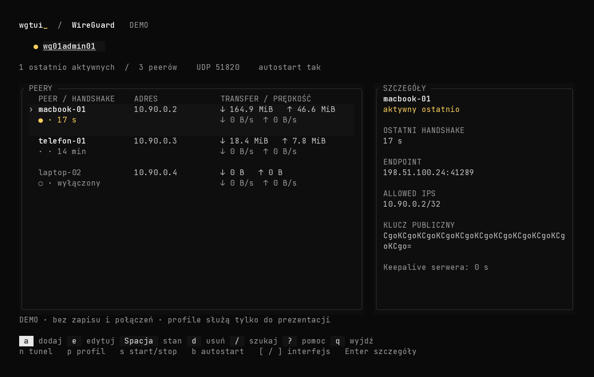

# wgtui

Minimalistyczne, klawiaturowe TUI do administracji WireGuardem na Debianie,
Ubuntu i Proxmoxie. Uruchamiasz je lokalnie na Linuksie albo po zwykłym
zalogowaniu przez SSH. Aplikacja zarządza zwykłymi konfiguracjami `wg-quick`
o nazwach `wgXXadminXX`, np. `wg01admin01`. Pozostałe interfejsy są widoczne
do podglądu.



## Motyw szymongalka-dark

Wygląd odwzorowuje aktywny arkusz `szymongalka-crt-20261009-v4.css`
z motywu Keycloaka `szymongalka-dark`: tło `#090a09`, grafitowe karty,
subtelne ramki, jasnoszary tekst i bursztynowy akcent `#ffcf5c`.
Zaznaczenie ma ciemne tło, pola formularzy jasną ramkę fokusu, a główne
skróty klawiszowe wyglądają jak małe przyciski. Paleta jest wspólna
dla wszystkich ekranów w `src/theme.rs`.

Kolory są stałe, również w jasnym terminalu. Do uzyskania typografii
z referencji ustaw JetBrains Mono w swoim terminalu. Aplikacja korzysta
z jego bieżącej czcionki; po wyjściu resetuje kolory terminala.
QR zachowuje własne czarne moduły, białe tło i pełny margines.

[Podgląd formularza dodawania peera](docs/peer-preview.png)

## Szybki podgląd

```sh
cd custom-tools/wgtui
cargo run --locked -- --demo
```

Demo działa również na macOS, bez root, WireGuarda, połączeń sieciowych
i zapisu konfiguracji. Dane i klucze demonstracyjne są fikcyjne; profil
DEMO nie służy do rzeczywistego połączenia. Do działania potrzebny jest
terminal minimum 80×24; szerokość od 110 znaków daje panel szczegółów.
QR wymaga większego okna zależnie od długości profilu.

## Instalacja na Linuksie

Najprościej pobierz uniwersalną paczkę **`dist/wgtui-linux.tar.gz`**
i przenieś ją na serwer. Zawiera obie architektury; instalator wybiera
właściwą automatycznie. Po zalogowaniu przez SSH:

```sh
tar -xzf wgtui-linux.tar.gz
cd wgtui-linux
sudo ./install.sh
sudo wgtui
```

Instalator sprawdza manifest SHA-256, architekturę i działanie binarki,
instaluje brakujące `wireguard-tools` oraz `iproute2` i dodaje polecenie
`wgtui` do `PATH`. Rust, Python i Ansible nie są potrzebne do tej instalacji.
Ponowne wykonanie aktualizuje binarkę i zachowuje zawartość istniejących
ustawień, szablonów oraz danych interfejsów. Katalogi prywatne mają `0700`,
a pliki ustawień i szablonów `0600`. Instalator nie uruchamia TUI ani
nie tworzy i nie zmienia tuneli, kluczy, zapory, routingu czy autostartu.

Jeśli pakiety utrzymujesz osobno przez Ansible lub instalujesz bez sieci:

```sh
sudo ./install.sh --skip-packages
```

Ta opcja sprawdza obecność zależności i nie uruchamia `apt-get`.
Gdy oba pakiety są już zainstalowane, również zwykła instalacja pomija apt.
`./install.sh --help` pokazuje pomoc. Uruchomiony z katalogu źródeł skrypt
korzysta z gotowych plików w `dist/`; nie kompiluje ani nie pobiera binarek.

Gotowe archiwa `dist/wgtui-linux-amd64.tar.gz` i
`dist/wgtui-linux-arm64.tar.gz` zawierają statyczną binarkę, szablony,
instalator `install.sh`, rolę Ansible, instrukcję i licencję. W ich katalogu
również wystarczy `sudo ./install.sh`. Obok archiwów jest suma SHA-256,
a wewnątrz manifest `SHA256SUMS`. Kompilator Rust nie jest
potrzebny na serwerze.

Zalecana jest rola Ansible z `ansible/roles/wgtui`. Przygotuj grupę
`wgtui_hosts` w swoim inventory i wykonaj z katalogu aplikacji:

```sh
ansible-playbook -i /ścieżka/do/inventory.yml ansible/install.yml
```

Przy instalacji Ansible z archiwum jednej architektury, w jego katalogu podaj
dołączoną binarkę dla właściwej architektury:

```sh
ansible-playbook -i /ścieżka/do/inventory.yml ansible/install.yml \
  -e "wgtui_binary_src=$PWD/bin/wgtui"
```

Rola dobiera binarkę z rozpakowanego katalogu `dist/` do architektury hosta.
Można podać własną przez zmienną `wgtui_binary_src`. Instaluje pakiety
`wireguard-tools`, `iproute2`, binarkę i początkowe szablony. Nie zmienia
tuneli, sysctl, NAT ani zapory. Kolejne uruchomienia zachowują zmienione
ustawienia i szablony (`force: false`).

Domyślny układ instalacji:

```text
/opt/custom-tools/wgtui/
├── bin/wgtui
├── settings.toml
├── templates/
│   ├── client.conf.tpl
│   └── profile.toml
└── interfaces/
    └── wg01admin01.toml      # endpoint, DNS, trasy, keepalive; bez kluczy

/usr/local/bin/wgtui          # dowiązanie do binarki
/etc/wireguard/
├── wg01admin01.conf          # własny klucz serwera i publiczne wpisy peerów
└── .wgtui/
    ├── locks/               # blokady wspólne dla różnych --data-dir
    └── transactions/        # znaczniki przerwanych operacji, bez sekretów
```

Uruchamianie:

```sh
sudo wgtui
sudo wgtui --interface wg01admin01
sudo wgtui --data-dir /inna/chroniona/ścieżka
```

Wymagane są systemd i uprawnienia root. Przy innej lokalizacji instalacji
przekaż również `--data-dir`. Aplikacja wymaga zwykłych plików właściciela,
z uprawnieniami `0600`, bez symlinków i dodatkowych hardlinków. Nie zmienia
automatycznie uprawnień istniejących konfiguracji.

## Klawiatura

| Klawisz | Działanie |
| --- | --- |
| `↑` / `↓`, `j` / `k` | Wybór peera |
| `←` / `→`, `[` / `]` | Zmiana interfejsu |
| `Tab` | Fokus na interfejsach / peerach |
| `Enter` | Szczegóły peera |
| `/` | Wyszukiwanie po nazwie, adresie lub kluczu |
| `a`, `e` | Dodaj / edytuj peera |
| `Spacja`, `d` | Włącz / wyłącz, usuń peera |
| `n`, `p` | Nowy tunel, profil następnych klientów |
| `s`, `b` | Uruchom / zatrzymaj, autostart systemd |
| `?`, `q` | Pomoc, zakończenie pracy |
| `Esc` | Wróć / anuluj / wyczyść filtr |

W formularzu `Tab` i `Shift+Tab` zmieniają pole, `Ctrl+U` czyści wartość,
`F10` lub `Ctrl+S` otwiera podgląd. `F2` przełącza sposób dodawania klucza.
Zwykłe skróty nie przechwytują tekstu formularzy. Obsługiwane jest wklejanie
pojedynczej linii przez bracketed paste.

## Dodawanie urządzenia

**Klucz publiczny:** wygeneruj klucz prywatny na urządzeniu klienta i wklej
do wgtui tylko publiczny. Sprawdź nazwę, proponowany adres i ustawienia
profilu. Podgląd pokazuje wpis `[Peer]` serwera oraz profil klienta.
Po zatwierdzeniu klient otrzymuje dane do wklejenia, z placeholderem
`<WKLEJ_KLUCZ_PRYWATNY_NA_URZADZENIU>`. Ten tryb nie tworzy kompletnego QR.

**Jednorazowy QR:** wgtui generuje klucze przez `wg genkey` / `wg pubkey`,
przechwytuje wynik w pamięci, a na serwerze zapisuje wyłącznie publiczny
klucz klienta. Po zatwierdzeniu pokazuje gotowy QR. `t` przełącza QR i tekst
profilu. Zaimportuj profil i dopiero wtedy potwierdź zamknięcie widoku.

Klucz prywatny klienta i profil z tym kluczem nie są zapisywane do plików,
logów, argumentów procesów ani schowka. Bufory sekretów są zerowane przy
zwalnianiu; sekrety nie implementują `Debug` ani serializacji. Zrzuty
pamięci procesu są wyłączone. Po zamknięciu profilu nie ma możliwości
ponownego pokazania QR. W razie utraty profilu usuń peera i dodaj go od nowa.
Odbiorca przechowuje własny klucz po imporcie; zasady zapisu aplikacji nie
kontrolują zapisu terminala, systemowego swapu ani zewnętrznego nagrywania.

## Tunele i adresacja

`n` proponuje pierwszy wolny `wg01adminNN`; oba człony numeryczne można
zmienić w zakresie `01–99`. Wpisz adres serwera IPv4 z prefiksem puli,
opcjonalny IPv6, port UDP oraz publiczny endpoint dla klientów. Wybierz
własną wolną podsieć — aplikacja nie pobiera adresów z historycznych
materiałów infrastruktury.

Domyślnie kreator tylko zapisuje tunel; uruchomienie i autostart to osobne
przełączniki. Własny klucz serwera jest trwały, w chronionym pliku
konfiguracji. Profile klientów domyślnie kierują ruch tylko do adresu
serwera w tunelu. Można wskazać dodatkowe podsieci; `/0` nie jest obsługiwane
w v1. Dostęp do podsieci wymaga odpowiednich reguł zapory, routingu
powrotnego i ewentualnie forwardingu przygotowanych osobno.

Wgtui proponuje wolne adresy `/32` i `/128`. Wyłączone peery nadal rezerwują
adresy. Nie obsługuje zmiany tras systemowych dla peerów site-to-site;
edycja adresów klientów ogranicza się do hostów w puli interfejsu. Pola
konfiguracji poza zmienianymi opcjami są zachowywane.

Ponowne włączenie wyłączonego peera wymaga nowego handshake’u klienta.
Odnowienie następuje zgodnie z timerami WireGuarda; dostęp może wrócić
po kilkunastu sekundach lub po ponownym włączeniu tunelu na urządzeniu.

## Szablony i monitoring

`p` edytuje endpoint, DNS, trasy i keepalive profilu danego interfejsu.
Formularz nowego klienta pozwala zmienić te wartości; podgląd informuje,
że zostaną zapamiętane jako ustawienia następnych klientów. Zmiana profilu
nie aktualizuje wcześniej zaimportowanych urządzeń.

Plik `templates/profile.toml` zawiera ustawienia początkowe nowych
interfejsów. `templates/client.conf.tpl` jest tekstowym szablonem z polami:
`{{private_key}}`, `{{address}}`, `{{dns_line}}`, `{{server_public_key}}`,
`{{endpoint}}`, `{{allowed_ips}}`, `{{keepalive_line}}`. Nie ma wykonywania
poleceń ani kodu szablonu. Nieznane placeholdery i zmiana adresów, klucza
lub tras przez szablon są odrzucane. Nie wpisuj kluczy do szablonów.

`settings.toml` ustala `active_seconds = 180`. Monitoring co sekundę
odczytuje publiczne pola `wg show`, bez `dump`. Prędkość jest różnicą
liczników pomiędzy próbkami; po resecie licznika zaczyna od zera.
„Aktywny ostatnio” oznacza niedawny handshake. WireGuard nie udostępnia
ścisłego stanu połączenia; brak ruchu i stary handshake nie dowodzą awarii.

## Zapis i odzyskiwanie po błędzie

Każda operacja wymaga podglądu i zatwierdzenia. Zapis używa blokady per
interfejs, ponownie porównuje plik z wersją podglądu, zapisuje atomowo
z `fsync`, a działający tunel aktualizuje przez `wg syncconf` z konfiguracją
przekazaną przez stdin. Aktualizacja peerów nie restartuje interfejsu ani
nie uruchamia hooków `wg-quick`. Zatrzymany tunel otrzymuje tylko zmianę
w pliku. `SaveConfig=true` blokuje zarządzanie, bo mogłoby nadpisać komentarze
i wyłączone wpisy przy zatrzymaniu usługi.

W razie błędu aplikacja przywraca poprzedni plik, profil i stan interfejsu
z kopii w pamięci. Nie tworzy kopii prywatnych kluczy w katalogu danych.
Przerwana operacja lub nieudane przywrócenie pozostawia znacznik:

```text
/etc/wireguard/.wgtui/transactions/wg01admin01.pending
```

Edycja pozostaje zablokowana. Sprawdź plik, stan `wg show` i usługę systemd.
Jeżeli wybranym źródłem prawdy jest sprawdzony plik konfiguracji, uzgodnij
działający interfejs poleceniem w powłoce Bash:

```sh
sudo bash -c 'wg syncconf wg01admin01 <(wg-quick strip wg01admin01)'
```

Po potwierdzeniu poprawnego stanu usuń wyłącznie odpowiedni plik `.pending`
i wróć do aplikacji. Polecenie może usuwać wpisy obecne tylko w aktywnym
interfejsie — najpierw porównaj stan. Znacznik nie zawiera sekretów.
Wgtui nie usuwa go automatycznie po awarii i nie nadpisuje rozbieżności.

## Kompilacja i testy

Wymagany Rust co najmniej 1.88; wersje zależności utrwala `Cargo.lock`.

```sh
cargo fmt --check
cargo test --locked
cargo clippy --locked --all-targets -- -D warnings
cargo build --locked --release
python3 scripts/smoke-pty.py
```

Statyczne cele Linuksa: `x86_64-unknown-linux-musl` i
`aarch64-unknown-linux-musl`. Można użyć `cross` z Dockerem:

```sh
cross build --locked --release --target x86_64-unknown-linux-musl
make package TARGET=x86_64-unknown-linux-musl ARCH=amd64
cross build --locked --release --target aarch64-unknown-linux-musl
make package TARGET=aarch64-unknown-linux-musl ARCH=arm64
make package-universal
```

Testy obejmują parser, IPv4/IPv6, walidację, wyłączone peery, konflikty
plików i blokad, wycofanie zmiany, pełen przepływ dodawania klienta,
brak jego klucza w plikach, klawiaturę, rozmiary TUI i QR dekodowany przez
niezależną bibliotekę `rqrr`.

Test prawdziwego WireGuarda uruchamiaj **w osobnej, jednorazowej VM Linux**
z root i pakietami `wireguard-tools`, `iproute2`, `iputils-ping`:

```sh
cargo test --locked --test linux_netns --no-run
sudo --preserve-env=PATH,CARGO_HOME,RUSTUP_HOME \
  cargo test --locked --test linux_netns -- --ignored --nocapture
```

Tworzy trzy osobne przestrzenie sieciowe, sprawdza handshake, dodanie
drugiego klienta bez resetu pierwszego i wyłączenie/włączenie klienta.
Sprząta przestrzenie po zakończeniu. Nie wymaga modyfikowania tuneli hosta.
Podgląd rzeczywistego bufora renderera można wygenerować do SVG:

```sh
cargo run --locked --example preview > target/preview.svg
cargo run --locked --example preview -- peer > target/peer.svg
```

Generator przyjmuje ekran `main`, `peer`, `tunnel`, `review`, `qr` lub
`error` oraz opcjonalnie szerokość i wysokość terminala. Obrazuje rzeczywisty
bufor Ratatui, łącznie z tłami i zaznaczeniem. `scripts/render-preview.py`
zamienia SVG w PNG z podanymi czcionkami TTF/WOFF2; wymaga Pillow,
a dla WOFF2 również fonttools i brotli. Czcionki nie są instalowane ani
dołączane do pakietów aplikacji.

Weryfikacja bazowej funkcjonalności 0.1.0: 24 testy przeszły na macOS i Debianie 13 ARM64,
a test jądra potwierdził działające profile klientów, handshake, dodanie
drugiego peera bez resetu pierwszego i wyłączenie/włączenie klienta.
Pełny TUI w prawdziwym terminalu przeszedł tworzenie tunelu i operacje
systemd. Rola Ansible przeszła instalację i ponowny przebieg `changed=0`,
z zachowaniem lokalnej zmiany szablonu. Binarka x86_64 została uruchomiona
na Linuksie przez QEMU. QR przeszedł niezależny dekoder; ręczny import
na fizycznym urządzeniu pozostaje do sprawdzenia.

Aktualizacja motywu przeszła 24 testy, Clippy i test rzeczywistego terminala.
Sprawdzono wygląd listy, formularzy i błędów również w 80×24.
QR z wyrenderowanego ekranu został poprawnie odczytany przez niezależny
dekoder ZXing, z zachowaniem pełnego profilu klienta.

Instalator ma cztery testy struktury i sum paczek:

```sh
python3 -m unittest discover -s tests -p 'test_installer_packaging.py' -v
bash -n install.sh
```

Test systemowy wymaga nowej, jednorazowej VM Linux bez istniejącej instalacji
wgtui; instaluje do rzeczywistych ścieżek `/opt` i `/usr/local/bin`:

```sh
sudo env WGTUI_DISPOSABLE_VM=1 bash tests/installer-smoke.sh dist/wgtui-linux.tar.gz
```

Weryfikacja instalatora z 22.10.2026 na lokalnej VM Debian 13 ARM64:
instalacja zależności i binarki, uprawnienia, ponowna instalacja z zachowaniem
ustawień i danych, brak zmian tuneli, odmowa uszkodzonej sumy, niezgodnej
architektury, dowiązania w miejsce ustawień, kolizji polecenia i drugiego
instalatora — wszystkie przypadki PASS. ShellCheck również PASS.
